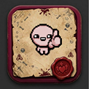

<h1 align="center">Runalyzer · The Binding of Isaac</h1>

Mira qué tienes desbloqueado en <b>The Binding of Isaac: Repentance+</b> (o Repentance) 
y qué te conviene sacar después, leyendo tu propia partida.

<a href="https://github.com/alexmarny/Runalyzer-TBOI/releases/latest/download/Runalyzer-setup.exe"><b>⬇ Descargar para Windows</b></a>
&nbsp;·&nbsp;
<a href="https://github.com/alexmarny/Runalyzer-TBOI/releases/latest/download/Runalyzer-SteamDeck.tar.gz"><b>⬇ Descargar para Steam Deck / Linux</b></a>
 Siempre la última versión · <a href="https://github.com/alexmarny/Runalyzer-TBOI/releases">todas las versiones</a>

---

## Qué hace

- Encuentra sola tus partidas (Steam Cloud, Documentos y, en la Deck, Proton y la tarjeta SD).
- Te enseña tus notas adhesivas por personaje, los logros que te faltan, los desafíos, la colección de objetos y el bestiario.
- Te propone a qué ir después: lo que abre zonas y personajes, los mejores premios a tu alcance y lo que conviene dejar para el final.
- **En directo:** deja la pestaña abierta mientras juegas y se actualiza sola cada vez que el juego guarda, enseñándote lo nuevo.

## Instalar en Windows

1. Descarga **[Runalyzer-setup.exe](https://github.com/alexmarny/Runalyzer-TBOI/releases/latest/download/Runalyzer-setup.exe)** y ábrelo.
2. Windows dirá **«Windows protegió su PC»**, porque el programa no está firmado (firmarlo cuesta dinero). Pulsa **«Más información»** y después **«Ejecutar de todas formas»**.
3. Pulsa **«Instalar»**. No pide permisos de administrador: se instala solo para tu usuario.
4. Al terminar se abre en tu navegador, con una pequeña intro. Desde entonces la tienes en el menú Inicio como **«Runalyzer»**. No abre ninguna ventana más: funciona en segundo plano y, al cerrar la pestaña, se apaga sola a los pocos minutos.

Para quitarla: *Configuración → Aplicaciones → Runalyzer → Desinstalar*.

## Instalar en Steam Deck (o Linux)

1. Pasa al **Modo Escritorio** (botón Steam → Apagar → Cambiar a escritorio). Necesitas un navegador; si no tienes, instala Firefox o Chrome desde Discover.
2. Descarga **[Runalyzer-SteamDeck.tar.gz](https://github.com/alexmarny/Runalyzer-TBOI/releases/latest/download/Runalyzer-SteamDeck.tar.gz)** y descomprímelo (clic derecho → Extraer → Extraer aquí).
3. Entra en la carpeta y haz doble clic en **Runalyzer** → «Ejecutar». Si dice que no se puede ejecutar: clic derecho → Propiedades → Permisos → marca «Es ejecutable».
4. Desde entonces la tienes en el menú de aplicaciones (en «Juegos»). No muevas la carpeta; si la mueves, ábrela una vez desde su sitio nuevo.

En la Deck, el modo en directo solo funciona si juegas desde el Modo Escritorio: al volver al Modo Juego se cierra el escritorio y la herramienta con él.

## Actualizaciones

No hay que volver a descargar nada. Al abrirla mira si hay una versión nueva y, si la hay, arriba de la página aparece **«Hay una versión nueva · Actualizar»**. Al pulsarlo la descarga, comprueba que el archivo está íntegro, la instala y se vuelve a abrir sola.

## Privacidad

- Tu partida **solo se lee**: el programa nunca la modifica ni la envía a ningún sitio.
- Todo funciona en tu ordenador: abre un servidor local (`127.0.0.1`) que solo atiende a la pestaña que abre él mismo.
- Solo se conecta a internet para preguntar a GitHub si hay una versión nueva. Sin internet funciona igual.

## Si algo no va

- **No encuentra mi partida:** cada ranura es un archivo `rep+persistentgamedataN.dat` (N = 1, 2 o 3). Con Steam Cloud está en `C:\Program Files (x86)\Steam\userdata\<tu número>\250900\remote\`; sin Steam Cloud, en `Documentos\My Games\Binding of Isaac Repentance+\`. Puedes pegar la ruta o elegir el archivo a mano en la página.
- **No se abre el navegador:** vuelve a abrir Runalyzer desde el menú Inicio; si ya estaba en marcha, abre otra pestaña con ella.
- **¿Es el archivo bueno?** Cada versión trae `SHA256SUMS.txt` con la suma de sus archivos. En Windows puedes comprobarla con `Get-FileHash Runalyzer-setup.exe` en PowerShell.

---

Herramienta no oficial, sin relación con Edmund McMillen ni Nicalis. Notas de prioridad según guías de la comunidad (The Cuck Chair, jnub). Descripciones de External Item Descriptions (EID); sprites del pack TBOI HD Sprites (u/villainero); imágenes y condiciones de los logros de la wiki de The Binding of Isaac en Fandom (CC BY-SA); nombres de logros y contadores de REPENTOGON. Este repositorio solo contiene las descargas; el código no es público.
